# AWS Terraform Assignment 05 --- Infrastructure with Terraform Modules

## Author

**Yogesh Indoria**

------------------------------------------------------------------------

## Table of Contents

1.  [Objective](#objective)
2.  [Assignment Overview](#assignment-overview)
3.  [Architecture Overview](#architecture-overview)
4.  [Project Structure](#project-structure)
5.  [Terraform Modules](#terraform-modules)
6.  [Network Design](#network-design)
7.  [Security Groups](#security-groups)
8.  [Application Infrastructure](#application-infrastructure)
9.  [RDS PostgreSQL](#rds-postgresql)
10. [Terraform State Management](#terraform-state-management)
11. [S3 Remote Backend](#s3-remote-backend)
12. [DynamoDB State Locking](#dynamodb-state-locking)
13. [Terraform Workflow](#terraform-workflow)
14. [Validation and Planning](#validation-and-planning)
15. [Infrastructure Deployment](#infrastructure-deployment)
16. [Deployment Result](#deployment-result)
17. [Terraform Outputs](#terraform-outputs)
18. [Verification Checklist](#verification-checklist)
19. [Cleanup](#cleanup)
20. [Conclusion](#conclusion)

------------------------------------------------------------------------

## Objective

The objective of this assignment is to design and implement AWS
infrastructure using **Terraform Modules**.

The configuration is organized into reusable, component-wise modules for
VPC, subnets, route tables, NAT Gateway, security groups, EC2, ALB,
target group, Auto Scaling Group, and RDS.

The assignment also demonstrates Terraform remote state management using
**Amazon S3** and state locking using **DynamoDB**.

------------------------------------------------------------------------

## Assignment Overview

This assignment focuses on:

-   Creating reusable Terraform modules.
-   Separating infrastructure components into individual modules.
-   Passing values between modules using variables and outputs.
-   Managing Terraform state remotely in Amazon S3.
-   Configuring state locking using DynamoDB.
-   Running Terraform formatting, validation, planning, and deployment.
-   Deploying the complete AWS infrastructure using Terraform.

> **Note:** Subnets are intentionally defined as explicit resources
> rather than using `for_each` or loops.

------------------------------------------------------------------------

## Architecture Overview

The infrastructure follows this flow:

``` text
                         Internet
                            |
                            v
                    +----------------+
                    |      ALB       |
                    |    Port 80     |
                    +-------+--------+
                            |
                            v
                +-----------------------+
                | SonarQube Target Group|
                |      Port 9000        |
                +-----------+-----------+
                            |
                            v
                 +---------------------+
                 | SonarQube ASG       |
                 | Private App Subnets |
                 +----------+----------+
                            |
                            v
                    +---------------+
                    | RDS PostgreSQL|
                    |    Port 5432  |
                    +---------------+

       Public Subnets
       /             \
   Bastion        NAT Gateway
                     |
                     v
                  Internet
```

------------------------------------------------------------------------

## Project Structure

``` text
TerraformAssignment02/
│
├── main.tf
├── variables.tf
├── outputs.tf
├── provider.tf
├── backend.tf
├── terraform.tfvars
├── terraform.tfvars.example
├── .gitignore
├── README.md
│
└── modules/
    ├── vpc/
    ├── subnet/
    ├── route-table/
    ├── nat-gateway/
    ├── security-group/
    ├── ec2/
    ├── alb/
    ├── target-group/
    ├── asg/
    └── rds/
```

------------------------------------------------------------------------

# Terraform Modules

Each major infrastructure component is implemented as a separate
reusable module.

## VPC Module

**Path:** `modules/vpc/`

Creates:

-   VPC
-   Internet Gateway

VPC CIDR:

``` text
10.0.0.0/16
```

### Screenshot


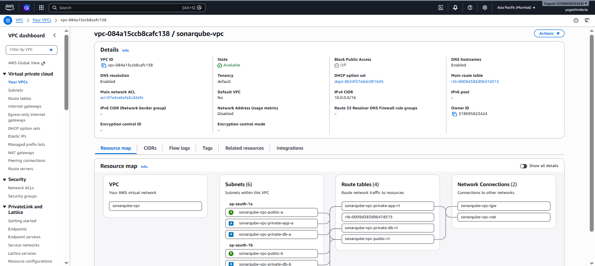


------------------------------------------------------------------------

## Subnet Module

**Path:** `modules/subnet/`

Six subnets are created across two Availability Zones.

  Layer         Subnet A       Subnet B
  ------------- -------------- --------------
  Public        10.0.1.0/24    10.0.2.0/24
  Private App   10.0.11.0/24   10.0.12.0/24
  Private DB    10.0.21.0/24   10.0.22.0/24

Availability Zones:

``` text
ap-south-1a
ap-south-1b
```

### Screenshot


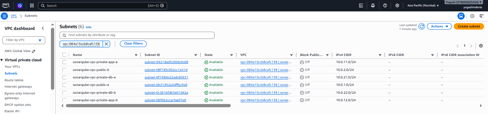


------------------------------------------------------------------------

## NAT Gateway Module

**Path:** `modules/nat-gateway/`

Creates:

-   Elastic IP
-   NAT Gateway

The NAT Gateway is placed in a public subnet and provides outbound
internet connectivity to the private application subnets.

### Screenshot


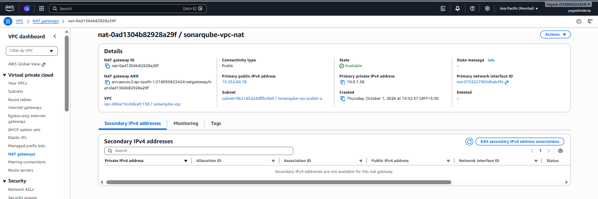

------------------------------------------------------------------------

## Route Table Module

**Path:** `modules/route-table/`

Creates:

### Public Route Table

``` text
0.0.0.0/0 → Internet Gateway
```

### Private Application Route Table

``` text
0.0.0.0/0 → NAT Gateway
```

### Private Database Route Table

The database subnets remain private and do not have a direct internet
route.

### Screenshot


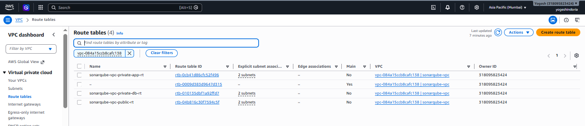

------------------------------------------------------------------------

## Security Group Module

**Path:** `modules/security-group/`

Creates four security groups:

1.  ALB Security Group
2.  Bastion Security Group
3.  Application Security Group
4.  RDS Security Group

### Security Flow

``` text
Internet
   |
   | TCP 80
   v
ALB
   |
   | TCP 9000
   v
SonarQube Application
   |
   | TCP 5432
   v
RDS PostgreSQL
```

### Screenshot

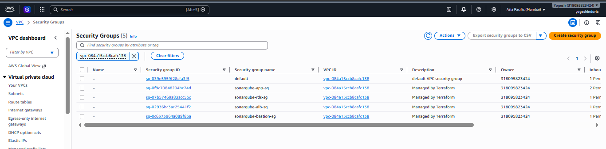


------------------------------------------------------------------------

## EC2 Module

**Path:** `modules/ec2/`

Creates the Bastion Host.

``` text
Instance Type: t3.micro
Subnet: Public Subnet A
Key Pair: VM2
```

### Screenshot


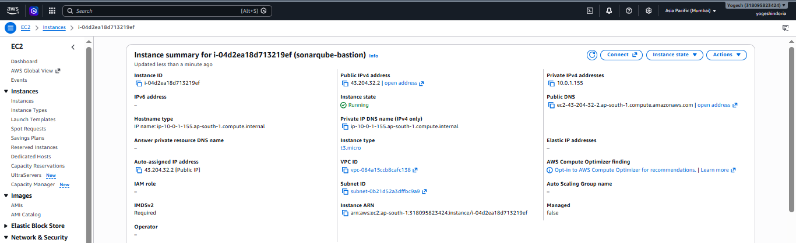

------------------------------------------------------------------------

## Target Group Module

**Path:** `modules/target-group/`

Configuration:

``` text
Port: 9000
Protocol: HTTP
Target Type: Instance
```

Health check:

``` text
Path: /api/system/status
Port: 9000
Protocol: HTTP
Matcher: 200
Interval: 30 seconds
Timeout: 10 seconds
Healthy Threshold: 2
Unhealthy Threshold: 5
```

### Screenshot


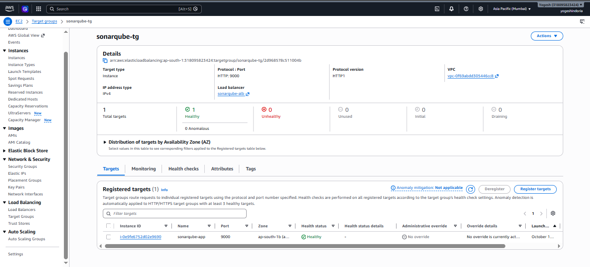

------------------------------------------------------------------------

## ALB Module

**Path:** `modules/alb/`

Creates an internet-facing Application Load Balancer in the public
subnets.

``` text
Protocol: HTTP
Port: 80
```

Traffic:

``` text
Internet → ALB : 80 → Target Group : 9000 → SonarQube
```

### Screenshot


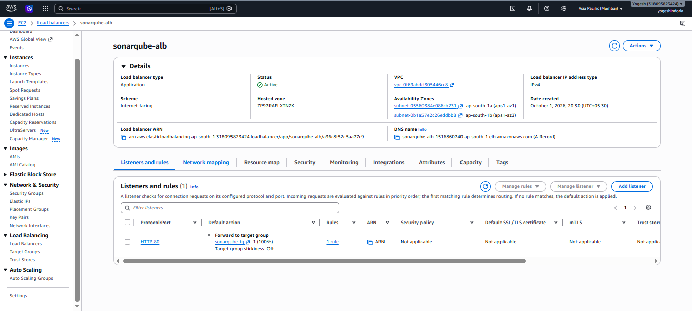

------------------------------------------------------------------------

## ASG Module

**Path:** `modules/asg/`

Auto Scaling Group configuration:

``` text
Desired Capacity: 1
Minimum Size: 1
Maximum Size: 1
Health Check Type: ELB
Health Check Grace Period: 400 seconds
```

Launch Template:

``` text
AMI: Amazon Linux 2023
Instance Type: c7i-flex.large
Key Pair: VM2
```

The Launch Template contains user data for SonarQube setup.

### Screenshot


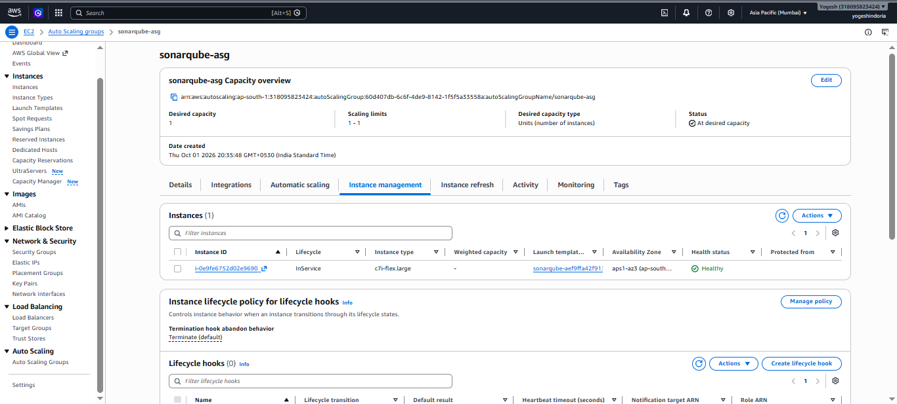

------------------------------------------------------------------------

## RDS Module

**Path:** `modules/rds/`

Creates PostgreSQL RDS in the private database subnets.

``` text
Engine: PostgreSQL
Engine Version: 15
Instance Class: db.t3.micro
Storage: 20 GB
Storage Type: gp3
Port: 5432
Publicly Accessible: false
```

### Screenshot


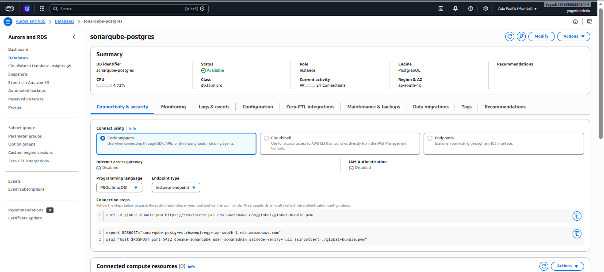

------------------------------------------------------------------------

# Network Design

VPC:

``` text
10.0.0.0/16
```

Subnets:

``` text
Public:
10.0.1.0/24
10.0.2.0/24

Private App:
10.0.11.0/24
10.0.12.0/24

Private DB:
10.0.21.0/24
10.0.22.0/24
```

Availability Zones:

``` text
ap-south-1a
ap-south-1b
```


------------------------------------------------------------------------

# Security Groups

### ALB Security Group

Allows internet traffic on:

``` text
TCP 80
```

### Bastion Security Group

Allows SSH:

``` text
TCP 22
```

### Application Security Group

Allows application traffic:

``` text
TCP 9000
```

### RDS Security Group

Allows database traffic:

``` text
TCP 5432
```

### Screenshot


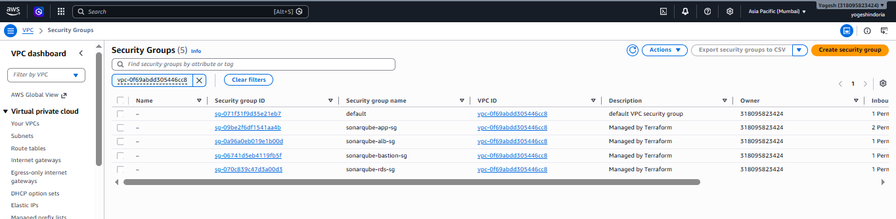

------------------------------------------------------------------------

# Application Infrastructure

Application flow:

``` text
Internet
   ↓
Application Load Balancer
   ↓
Target Group
   ↓
Auto Scaling Group
   ↓
SonarQube
   ↓
RDS PostgreSQL
```

The application servers are deployed in private application subnets,
while the ALB is deployed in public subnets.

------------------------------------------------------------------------

# RDS PostgreSQL

The database is private and is not publicly accessible.

``` text
Engine              = PostgreSQL
Version             = 15
Instance Class      = db.t3.micro
Storage             = 20 GB gp3
Port                = 5432
Publicly Accessible = false
```

------------------------------------------------------------------------

# Terraform State Management

Terraform state is stored remotely in Amazon S3.

Backend:

``` text
Bucket:
ass5-sonarqube-terraform-state

Key:
assignment-05/sonarqube/terraform.tfstate

Region:
ap-south-1
```

Encryption:

``` hcl
encrypt = true
```

### Screenshot


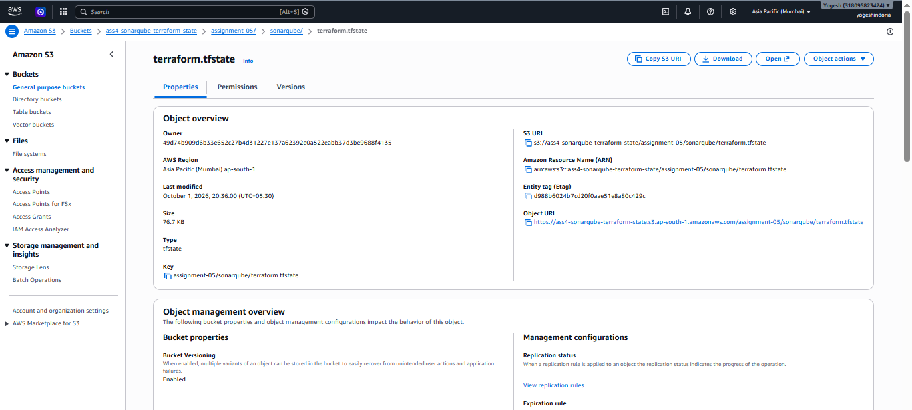

------------------------------------------------------------------------

# S3 Remote Backend

The backend is configured in `backend.tf`.

``` hcl
terraform {
  backend "s3" {
    bucket         = "ass4-sonarqube-terraform-state"
    key            = "assignment-05/sonarqube/terraform.tfstate"
    region         = "ap-south-1"
    encrypt        = true
    use_lockfile   = true
    dynamodb_table = "ass5-sonarqube-terraform-lock"
  }
}
```

The S3 bucket stores the Terraform state remotely.

------------------------------------------------------------------------

# DynamoDB State Locking

DynamoDB table created for the assignment:

``` text
Table Name: ass5-sonarqube-terraform-lock
Partition Key: LockID
Type: String
Billing Mode: PAY_PER_REQUEST
Status: ACTIVE
```

> **Note:** Current Terraform versions mark the `dynamodb_table` backend
> argument as deprecated and recommend S3 native locking with
> `use_lockfile`. The DynamoDB table is retained here because the
> assignment explicitly requires DynamoDB state locking.

------------------------------------------------------------------------

# Terraform Workflow

``` text
Terraform Code
      |
      v
terraform fmt -recursive
      |
      v
terraform init
      |
      v
terraform validate
      |
      v
terraform plan
      |
      v
terraform apply
      |
      v
AWS Infrastructure
```

------------------------------------------------------------------------

# Validation and Planning

## Format

``` bash
terraform fmt -recursive
```

## Initialize

``` bash
terraform init
```

For backend reconfiguration:

``` bash
terraform init -reconfigure
```

## Validate

``` bash
terraform validate
```

Validation completed successfully.

### Screenshot


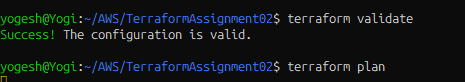

------------------------------------------------------------------------

# Terraform Plan

Command:

``` bash
terraform plan
```

Final plan:

``` text
Plan: 31 to add, 0 to change, 0 to destroy.
```

### Screenshot


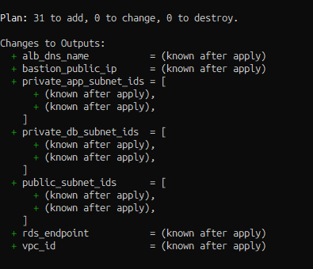

------------------------------------------------------------------------

# Infrastructure Deployment

Command:

``` bash
terraform apply
```

Terraform requested interactive approval before deployment.

The deployment completed successfully.

Final result:

``` text
Apply complete! Resources: 31 added, 0 changed, 0 destroyed.
```

### Screenshot


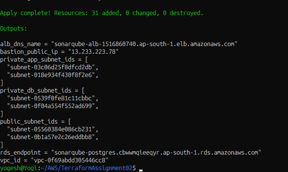

------------------------------------------------------------------------

# Deployment Result

Terraform successfully created:

``` text
31 resources
0 changes
0 destructions
```

Resources include:

-   VPC
-   Internet Gateway
-   Six Subnets
-   Route Tables
-   Route Table Associations
-   NAT Gateway
-   Elastic IP
-   Security Groups
-   Bastion EC2
-   Application Load Balancer
-   ALB Listener
-   Target Group
-   Launch Template
-   Auto Scaling Group
-   RDS PostgreSQL
-   RDS Subnet Group

------------------------------------------------------------------------

# Terraform Outputs

The deployment generated:

``` text
alb_dns_name
bastion_public_ip
private_app_subnet_ids
private_db_subnet_ids
public_subnet_ids
rds_endpoint
vpc_id
```

Command:

``` bash
terraform output
```

### Screenshot


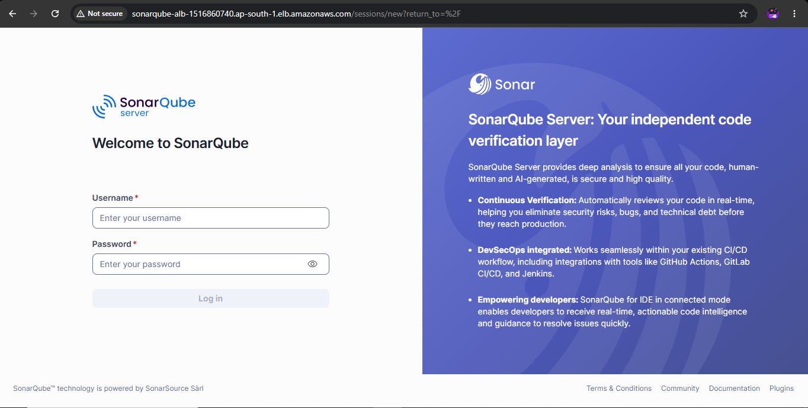

------------------------------------------------------------------------

# Verification Checklist

  Component                   Status
  --------------------------- --------
  Terraform Modules           ✅
  VPC                         ✅
  Internet Gateway            ✅
  Public Subnets              ✅
  Private App Subnets         ✅
  Private DB Subnets          ✅
  Route Tables                ✅
  NAT Gateway                 ✅
  Elastic IP                  ✅
  Security Groups             ✅
  Bastion EC2                 ✅
  Application Load Balancer   ✅
  ALB Listener                ✅
  Target Group                ✅
  Launch Template             ✅
  Auto Scaling Group          ✅
  RDS PostgreSQL              ✅
  S3 Remote State             ✅
  DynamoDB Lock Table         ✅
  Terraform Validation        ✅
  Terraform Plan              ✅
  Terraform Apply             ✅

------------------------------------------------------------------------

# Cleanup

After completing the assignment and collecting required screenshots:

``` bash
terraform destroy
```

Review the resources before confirming destruction.

After destruction, verify that billable resources such as:

-   NAT Gateway
-   RDS
-   ALB
-   EC2
-   Elastic IP

are no longer running.

> The S3 state bucket and DynamoDB lock table are backend resources and
> should only be removed after the Terraform project no longer needs the
> remote backend.

### Screenshot


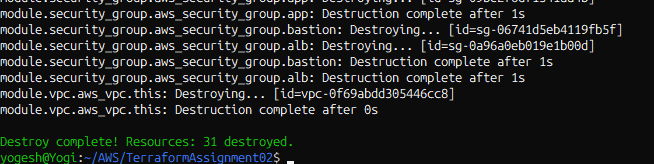

------------------------------------------------------------------------

# Conclusion

This assignment demonstrates how AWS infrastructure can be implemented
using **Terraform Modules**.

The infrastructure was divided into reusable modules for networking,
security, compute, load balancing, auto scaling, and database
components.

Terraform state was configured using an **Amazon S3 remote backend**,
with S3 native locking and a DynamoDB lock table for the assignment
requirement.

The complete infrastructure was successfully deployed with:

``` text
31 resources added
0 resources changed
0 resources destroyed
```

This modular approach improves infrastructure organization, reusability,
consistency, and maintainability.

------------------------------------------------------------------------

## Author

**Yogesh Indoria**

**AWS \| Terraform \| DevOps**
