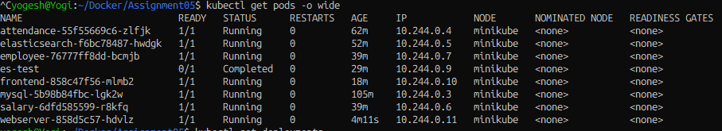
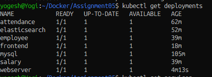
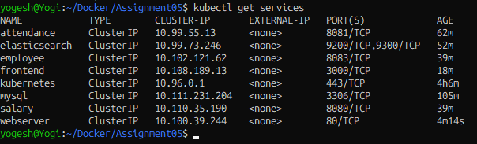
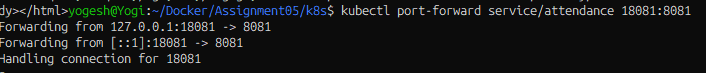
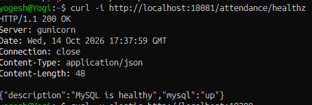
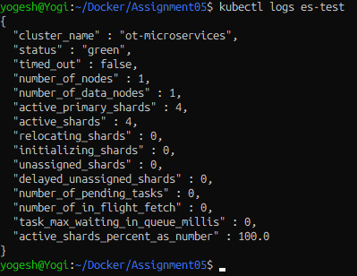
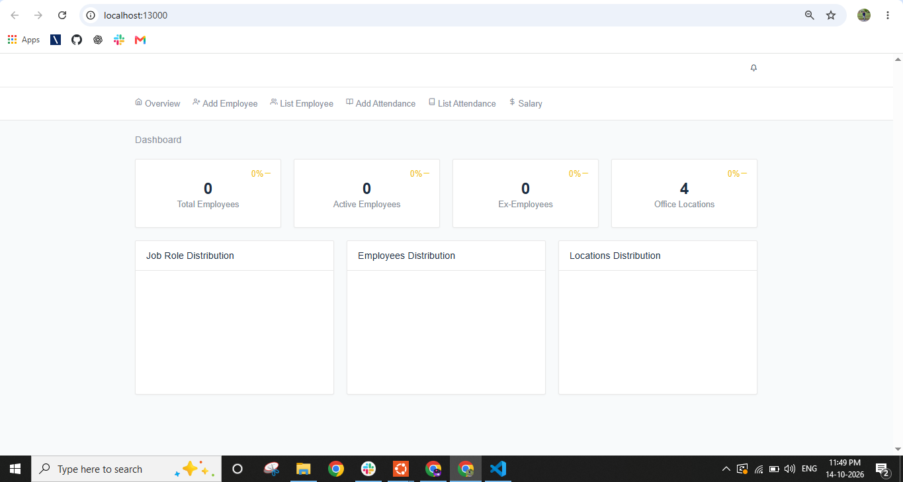

# Kubernetes Assignment 5 — OT-Microservices

**Author:** Yogesh Indoria

## Objective

Deploy the OT-Microservices application components as Kubernetes workloads on a local Minikube cluster running in WSL Ubuntu 24.04 with Docker. Create Kubernetes Deployments and ClusterIP Services, configure application settings, and validate that the components start and can be accessed.

## Environment

- OS: Ubuntu 24.04 on WSL
- Container runtime: Docker
- Kubernetes cluster: Minikube
- Kubernetes CLI: `kubectl`
- Application images: `yogeshindoria/ot-empms-*`

## Architecture

The following components were deployed:

| Component | Kubernetes resource | Service port | Purpose |
|---|---|---:|---|
| MySQL | Deployment + ClusterIP Service | 3306 | Stores attendance data |
| Attendance | Deployment + ClusterIP Service | 8081 | Attendance API; connects to MySQL |
| Elasticsearch | Deployment + ClusterIP Service | 9200, 9300 | Search/indexing backend |
| Salary | Deployment + ClusterIP Service | 8080 | Salary API; configured to use Elasticsearch |
| Employee | Deployment + ClusterIP Service | 8083 | Employee API; configured to use Elasticsearch |
| Frontend | Deployment + ClusterIP Service | 3000 | Web UI |
| Webserver (Nginx) | Deployment + ClusterIP Service | 80 | Webserver validation |

> Note: This assignment used separate MySQL and Attendance Pods (Option 1). The alternate combined Attendance + MySQL Pod option was not implemented.

## Repository structure

```text
Assignment05/
├── problem_statement.txt
├── images/
│   ├── <screenshots saved here>
└── k8s/
    ├── mysql.yaml
    ├── mysql-secret.yaml
    ├── attendance.yaml
    ├── elasticsearch.yaml
    ├── elasticsearch-secret.yaml
    ├── salary.yaml
    ├── employee.yaml
    ├── frontend.yaml
    ├── webserver.yaml
    └── es-test.yaml
```

## Deployment steps

Run these commands from the `k8s` directory:

```bash
cd ~/Docker/Assignment05/k8s
```

### 1. Apply Secrets

The Secret manifests contain sensitive data. Do not commit them to a public repository.

```bash
kubectl apply -f mysql-secret.yaml
kubectl apply -f elasticsearch-secret.yaml
```

### 2. Deploy MySQL and Attendance

```bash
kubectl apply -f mysql.yaml
kubectl apply -f attendance.yaml
```

Attendance reads its configuration from `/app/config/config.yaml`. The Kubernetes configuration uses the `mysql` Service hostname instead of the old Docker bridge IP.

### 3. Deploy Elasticsearch

```bash
kubectl apply -f elasticsearch.yaml
```

Elasticsearch was configured for a single-node local cluster with a reduced Java heap suitable for the available development environment.

### 4. Deploy Salary and Employee

```bash
kubectl apply -f salary.yaml
kubectl apply -f employee.yaml
```

Both application configurations use the Kubernetes Service hostname `elasticsearch` on port `9200`.

### 5. Deploy Frontend and Webserver

```bash
kubectl apply -f frontend.yaml
kubectl apply -f webserver.yaml
```

## Validation

### Check Pods

```bash
kubectl get pods -o wide
```

**Screenshot 1 — All application Pods**



### Check Deployments

```bash
kubectl get deployments
```

**Screenshot 2 — Deployment availability**



### Check Services

```bash
kubectl get services
```

**Screenshot 3 — Kubernetes Services and ports**



### Validate Attendance to MySQL

Forward the Attendance Service port:

```bash
kubectl port-forward service/attendance 18081:8081
```

In another terminal:

```bash
curl -i http://localhost:18081/attendance/healthz
```

Expected successful response:

```json
{
  "description": "MySQL is healthy",
  "mysql": "up"
}
```

**Screenshot 4 — Attendance health check**




### Validate Elasticsearch

A temporary test Pod was used to query the cluster health endpoint with credentials supplied from a Kubernetes Secret.

```bash
kubectl logs es-test
```

The observed result was `status: green`, one node, and 100% active primary shards.

**Screenshot 5 — Elasticsearch cluster health**



### Access the Frontend

```bash
kubectl port-forward service/frontend 13000:3000
```

Open [http://localhost:13000](http://localhost:13000) in a browser.

**Screenshot 6 — Frontend in browser**



### Access the Nginx Webserver

```bash
kubectl port-forward service/webserver 18080:80
```

Open [http://localhost:18080](http://localhost:18080) in a browser. The expected page is the Nginx welcome page.

**Screenshot 7 — Nginx welcome page**


## Final observed status

At the final check, the following seven application Pods were `Running` and each corresponding Deployment showed `1/1` available:

- MySQL
- Attendance
- Elasticsearch
- Salary
- Employee
- Frontend
- Webserver (Nginx)

The temporary `es-test` Pod showed `Completed`, which is expected for a one-time health-check command.

## Important notes and limitations

- The demonstrated setup is for local learning with Minikube, not production deployment.
- The MySQL Deployment currently has no persistent volume configured; data may be lost if its Pod is recreated.
- Kubernetes Secret values should be treated as sensitive. Base64 encoding is not encryption; avoid committing Secret YAML files to a public repository. Prefer a secret manager or a secure deployment process for real environments.
- The frontend was confirmed accessible through port-forwarding.
- Application startup was verified for Salary and Employee. Successful startup alone does not prove every application-level Elasticsearch query works; endpoint-level integration testing is recommended.
- This implementation covers Assignment Option 1: MySQL and Attendance run in separate Pods.

## Cleanup (only when finished)

To remove the deployed application resources from the current namespace:

```bash
kubectl delete -f webserver.yaml
kubectl delete -f frontend.yaml
kubectl delete -f employee.yaml
kubectl delete -f salary.yaml
kubectl delete -f elasticsearch.yaml
kubectl delete -f attendance.yaml
kubectl delete -f mysql.yaml
kubectl delete -f elasticsearch-secret.yaml
kubectl delete -f mysql-secret.yaml
```

Do not run cleanup until you have captured the required screenshots and no longer need the cluster resources.

---
**Author:** Yogesh Indoria
