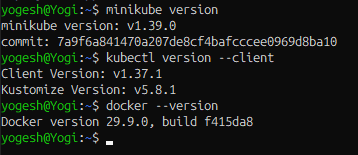
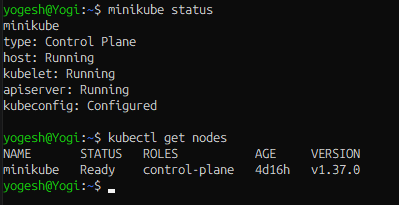
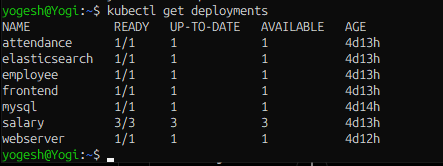
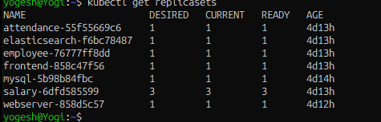
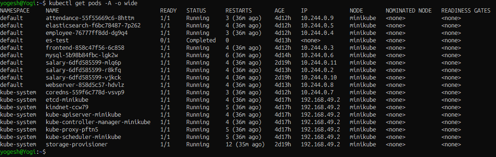
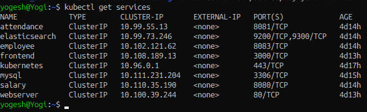
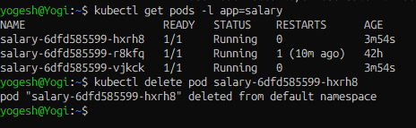
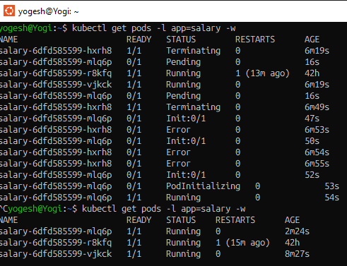

# Assignment 6 --- OT-Microservice Application using Deployments and ReplicaSets

**Author:** Yogesh Indoria

## Objective

Understand and implement Kubernetes **Deployments** and **ReplicaSets**
by deploying the OT-Microservice application. Verify that Deployments
manage ReplicaSets, ReplicaSets maintain the desired number of Pods, and
Kubernetes replaces a deleted Pod to maintain the desired state.

## Index

1.  [Assignment Overview](#assignment-overview)
2.  [Prerequisites](#prerequisites)
3.  [Step 1 --- Check Minikube and Cluster
    Status](#step-1--check-minikube-and-cluster-status)
4.  [Step 2 --- Review Existing OT-Microservice
    Deployments](#step-2--review-existing-ot-microservice-deployments)
5.  [Step 3 --- Review ReplicaSets](#step-3--review-replicasets)
6.  [Step 4 --- Review Pods](#step-4--review-pods)
7.  [Step 5 --- Review Kubernetes YAML
    Manifests](#step-5--review-kubernetes-yaml-manifests)
8.  [Step 6 --- Verify Application
    Services](#step-6--verify-application-services)
9.  [Step 7 --- Demonstrate ReplicaSet
    Self-Healing](#step-7--demonstrate-replicaset-self-healing)

------------------------------------------------------------------------

## Assignment Overview

**Assignment statement:** Deploy the OT-Microservice application using
Kubernetes Deployments and ReplicaSets.

The existing application includes these components:

-   Attendance
-   Employee
-   Salary
-   MySQL
-   Elasticsearch
-   Frontend
-   Webserver

> **Important:** Run commands from the appropriate project directory
> where required. Do not delete or recreate the Minikube cluster as part
> of this assignment unless you have backed up anything important and
> intentionally decided to rebuild it.

## Prerequisites

-   Docker
-   Minikube
-   `kubectl`
-   OT-Microservice Kubernetes YAML manifests
-   Access to the application container images

Check the installed tools:

``` bash
minikube version
kubectl version --client
docker --version
```

**Screenshot 0 --- Tool versions**





------------------------------------------------------------------------

## Step 1 --- Check Minikube and Cluster Status

Check Minikube:

``` bash
minikube status
```

Check the Kubernetes node:

``` bash
kubectl get nodes
```

**Expected result:** Minikube services should be running and the node
should show `Ready`.

**Screenshot 1 --- Minikube and node status**



## Step 2 --- Review Existing OT-Microservice Deployments

List all Deployments:

``` bash
kubectl get deployments
```

Describe a Deployment for more details (replace `<deployment-name>` with
an actual name):

``` bash
kubectl describe deployment <deployment-name>
```

Check the Deployments for Attendance, Employee, Salary, MySQL,
Elasticsearch, Frontend, and Webserver where applicable.

**Screenshot 2 --- Deployments**




## Step 3 --- Review ReplicaSets

List ReplicaSets:

``` bash
kubectl get replicasets
```

To inspect a ReplicaSet:

``` bash
kubectl describe replicaset <replicaset-name>
```

Check the `DESIRED`, `CURRENT`, and `READY` counts. A Deployment
normally creates and manages its ReplicaSet.

**Screenshot 3 --- ReplicaSets**




## Step 4 --- Review Pods

List Pods across namespaces:

``` bash
kubectl get pods -A -o wide
```

Inspect a Pod if it is not ready or is restarting:

``` bash
kubectl describe pod <pod-name>
kubectl logs <pod-name> --tail=50
```

**Expected result:** The required application Pods should become
`Running` and show their expected readiness status. A Pod being
`Running` alone does not prove that the whole application is connected
correctly.

**Screenshot 4 --- Pod status**




## Step 5 --- Review Kubernetes YAML Manifests

List YAML manifests in the current directory:

``` bash
ls -l *.yaml
```

If the manifests are stored in another directory, change to that
directory first.

For each applicable application component, review the manifest and
confirm that it uses a Deployment (`kind: Deployment`) with a suitable
`spec.replicas`, selector, Pod template, labels, container image, and
container configuration.

Typical Deployment structure:

``` yaml
apiVersion: apps/v1
kind: Deployment
metadata:
  name: example
spec:
  replicas: 1
  selector:
    matchLabels:
      app: example
  template:
    metadata:
      labels:
        app: example
    spec:
      containers:
        - name: example
          image: YOUR_ACTUAL_IMAGE
```

This is an **illustrative example only**. Do not apply it as-is or
replace working application manifests without adapting it to the actual
image, ports, environment variables, configuration, and dependencies.

Validate and apply manifests only after reviewing them:

``` bash
kubectl apply --dry-run=client -f <manifest-file>.yaml
kubectl apply -f <manifest-file>.yaml
```

Run these commands for the actual manifest files as appropriate. If the
application is already deployed and healthy, avoid applying unreviewed
changes.

## Step 6 --- Verify Application Services

List Services:

``` bash
kubectl get services
```


**Screenshot 6 --- Services and verification**

Save as `screenshots/06-services-verification.png`.

 

## Step 7 --- Demonstrate ReplicaSet Self-Healing

> Use a non-critical test Deployment for this demonstration, or choose
> an application Pod only if deleting it is safe for your assignment. Do
> not delete database Pods if doing so could risk data or interrupt your
> application.

Check the target Deployment and its Pods:

``` bash
kubectl get deployments
kubectl get pods
```

Choose a Deployment that has a ReplicaSet managing its Pods. Record the
Pod names and desired replica count. Delete **one Pod** managed by that
Deployment (replace `<pod-name>` with the exact Pod name):

``` bash
kubectl delete pod <pod-name>
```

Watch the Pods:

``` bash
kubectl get pods -w
```

Stop watching with `Ctrl+C`. Then verify:

``` bash
kubectl get deployments
kubectl get replicasets
kubectl get pods
```

**Expected result:** If the Deployment's ReplicaSet is healthy and the
cluster can create Pods, Kubernetes should create a replacement Pod and
work toward the desired replica count. Pod names will differ because the
replacement is a new Pod.

**Screenshot 7A --- Before deleting a Pod**


  

**Screenshot 7B --- Pod deletion and replacement**




------------------------------------------------------------------------

**Author:** Yogesh Indoria
