# Docker Assignment 01

**Author:** Yogesh Indoria\
**Team:** Pirates\
**Assignment:** Docker Assignment 01

------------------------------------------------------------------------

## Objective

The objective of this assignment is to gain hands-on experience with
Docker containers, Nginx, static website hosting, container runtime
configuration, time-based application logic, Linux users, groups, file
ownership, and permissions.

This assignment is divided into two parts:

-   **Part 1:** Host a static website using Docker and serve different
    messages based on the current time.
-   **Part 2:** Create a directory structure inside a container and
    configure user-specific read/write permissions.

Screenshots and execution proof will be added at the relevant steps.

------------------------------------------------------------------------

# Part 1 --- Static Website Hosting Using Docker

## Objective

Create a Docker-based utility to host a static website with the
following requirements:

-   Website should be accessible using the team domain:
    -   `yogesh.pirates.com`
-   Website should be available during:
    -   **10:00 AM -- 12:00 PM**
    -   **4:00 PM -- 6:00 PM**
-   During the first time window, the website should display:
    -   `Hello from Yogesh`
-   During the second time window, the website should display:
    -   `Hello from Shubham Rathi`
-   Outside these working hours, the website should display an
    unavailable message.
-   The HTML page remains static while the runtime configuration is
    updated dynamically.

## Technologies Used

-   Docker
-   Dockerfile
-   Nginx
-   Shell Script
-   HTML
-   JavaScript
-   Linux
-   Windows Hosts File

## Project Structure

``` text
Part1/
├── Dockerfile
├── entrypoint.sh
├── config.js
├── index.html
└── nginx.conf
```

## Architecture

``` text
Browser
   |
   | http://yogesh.pirates.com
   v
Windows Hosts File
   |
   | 127.0.0.1
   v
Docker Container
   |
   v
Nginx :80
   |
   +----> index.html
   |
   +----> config.js
             ^
             |
        entrypoint.sh
             |
        Current IST Time
             |
       +-----+-----+
       |           |
    10-12         4-6
       |           |
     Yogesh      Shubham
```

## Step 1 --- Create the Dockerfile

The Dockerfile uses the lightweight Nginx Alpine image and copies the
required website files and startup script into the container.

The container timezone is configured as `Asia/Kolkata` so that the
time-based logic works according to Indian Standard Time.

### Dockerfile

``` dockerfile
FROM nginx:alpine

RUN apk add --no-cache tzdata

ENV TZ=Asia/Kolkata

COPY nginx.conf /etc/nginx/conf.d/default.conf
COPY index.html /usr/share/nginx/html/index.html
COPY entrypoint.sh /entrypoint.sh

RUN chmod +x /entrypoint.sh

EXPOSE 80

ENTRYPOINT ["/entrypoint.sh"]
```


------------------------------------------------------------------------

## Step 2 --- Configure Nginx

Nginx is configured to listen on port `80` and serve the static website
from:

``` text
/usr/share/nginx/html
```

The server name used for the assignment is:

``` text
yogesh.pirates.com
```


------------------------------------------------------------------------

## Step 3 --- Dynamic Time-Based Configuration

The `entrypoint.sh` script checks the current time and generates
`config.js`.

The HTML page itself remains static. Only the configuration values
change according to the current time.

### Logic

``` text
10:00 AM – 12:00 PM
        ↓
Hello from Yogesh

4:00 PM – 6:00 PM
        ↓
Hello from Shubham Rathi

Outside working hours
        ↓
Website currently unavailable
```

The configuration is refreshed periodically while the container is
running.


------------------------------------------------------------------------

## Step 4 --- Build Docker Image

The Docker image was built using:

``` bash
docker build -t yogesh-pirates:v1 .
```

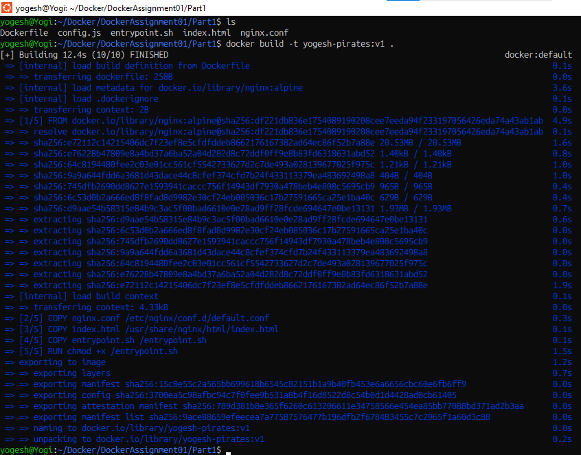

------------------------------------------------------------------------

## Step 5 --- Run the Container

The container was started using:

``` bash
docker run -d \
  --name yogesh-pirates \
  -p 80:80 \
  yogesh-pirates:v2
```

Verify the running container:

``` bash
docker ps
```

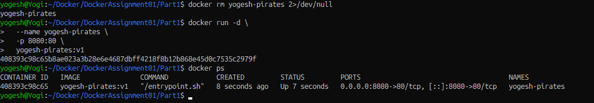

## Step 6 --- Configure the Team Domain

The local hosts file was configured to resolve the assignment domain to
the local machine.

``` text
127.0.0.1    yogesh.pirates.com
```

This allows the domain to be accessed locally without registering a real
public DNS record.


------------------------------------------------------------------------

## Step 7 --- Access the Website

The website can be accessed using:

``` text
http://yogesh.pirates.com
```

Nginx receives the request and serves the static HTML page.

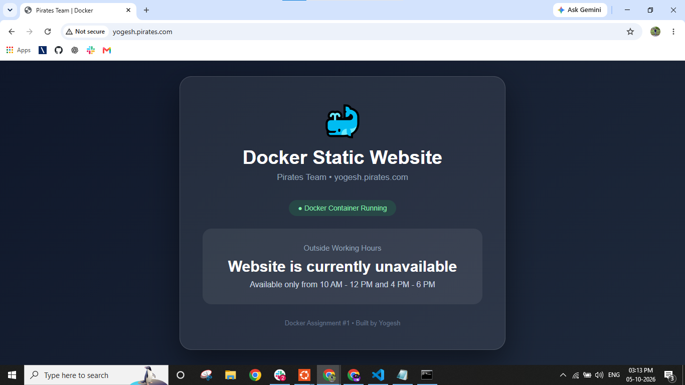  
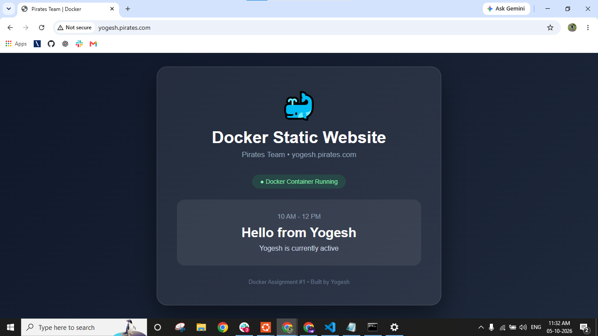
  
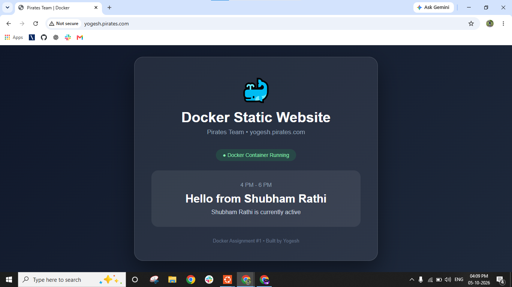


------------------------------------------------------------------------

## Step 8 --- Verify Dynamic Configuration

The generated configuration inside the container can be checked using:

``` bash
docker exec yogesh-pirates cat /usr/share/nginx/html/config.js
```

This verifies that the runtime configuration is being generated
according to the current time.


------------------------------------------------------------------------

## Part 1 Result

Part 1 successfully demonstrates:

-   Docker image creation
-   Docker container execution
-   Nginx static website hosting
-   Local domain mapping
-   Time-based application logic
-   Dynamic configuration generation
-   IST timezone configuration
-   Different responses for different time windows

**Part 1 Status: Completed**

------------------------------------------------------------------------

# Part 2 --- User-Based File Permissions

## Objective

Create a new container containing the following directory structure:

``` text
Data/
└── Ninjas/
    ├── Yogesh/
    └── Bhumika/
```

For this implementation, two users will be used:

-   `Yogesh`
-   `Bhumika`

The objective is to configure permissions so that each user can:

-   **Write** inside their own directory.
-   **Read** the other user's directory.
-   **Not modify** the other user's directory.

## Expected Permission Model

  User      Yogesh Directory   Bhumika Directory
  --------- ------------------ -------------------
  Yogesh    Read + Write       Read only
  Bhumika   Read only          Read + Write

### Permission Concept

``` text
                    Data/Ninjas
                        |
              +---------+---------+
              |                   |
           Yogesh             Bhumika
              |                   |
        Owner: Yogesh       Owner: Bhumika
        RW access           RW access
              |                   |
        Bhumika: Read       Yogesh: Read
```

## Step 1 --- Create the Container

A Linux-based Docker container will be used to create and test the users
and permissions.

Example:

``` bash
docker run -it --name docker-permission-assignment ubuntu:24.04 bash
```

## Step 2 --- Create Users

Inside the container:

``` bash
useradd -m Yogesh
useradd -m Bhumika
```

Verify:

``` bash
id Yogesh
id Bhumika
```

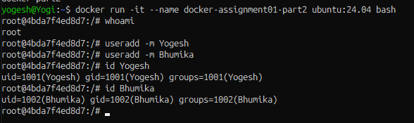


------------------------------------------------------------------------

## Step 3 --- Create Directory Structure

``` bash
mkdir -p /Data/Ninjas/Yogesh
mkdir -p /Data/Ninjas/Bhumika
```

Verify:

``` bash
tree /Data
```

If `tree` is not installed, use:

``` bash
find /Data -type d
```

Expected structure:

``` text
/Data
└── Ninjas
    ├── Yogesh
    └── Bhumika
```

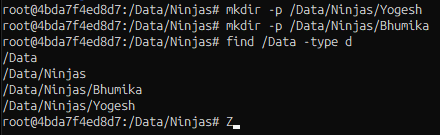  


------------------------------------------------------------------------

## Step 4 --- Configure Ownership and Permissions

The ownership and permissions will be configured so that:

-   Yogesh owns `Yogesh/`.
-   Bhumika owns `Bhumika/`.
-   Both users can read the other user's directory.
-   Only the owner can write to their own directory.

Example permission model:

``` text
Yogesh directory   → owner: Yogesh   → rwx
Bhumika directory  → owner: Bhumika  → rwx
```

Read access for the other user will be provided without giving write
permission.

The final permission configuration will be verified using:

``` bash
ls -ld /Data/Ninjas/Yogesh
ls -ld /Data/Ninjas/Bhumika
```

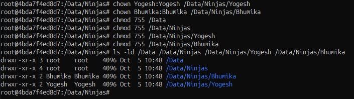  
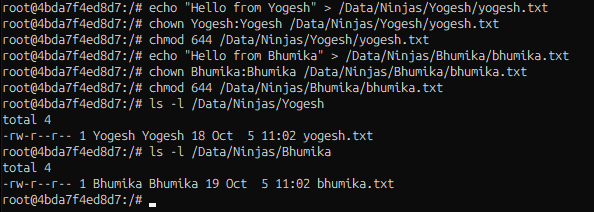  
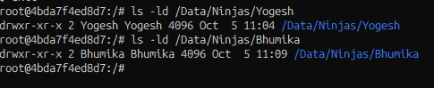


------------------------------------------------------------------------

## Step 5 --- Test as Yogesh

Switch to the `Yogesh` user:

``` bash
su - Yogesh
```

Verify that Yogesh can create/write a file in the Yogesh directory.

Expected:

``` bash
echo "Yogesh can write here" > /Data/Ninjas/Yogesh/test.txt
```

This should succeed.

Then verify that Yogesh can read the Bhumika directory.

Expected:

``` bash
cat /Data/Ninjas/Bhumika/bhumika.txt
```

This should succeed.

Attempting to create or modify a file inside Bhumika's directory should
fail because Yogesh has read-only access.

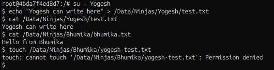

------------------------------------------------------------------------

## Step 6 --- Test as Bhumika

Switch to the `Bhumika` user:

``` bash
su - Bhumika
```

Verify that Bhumika can create/write a file in the Bhumika directory.

Expected:

``` bash
touch /Data/Ninjas/Bhumika/test.txt
```

This should succeed.

Then verify that Bhumika can read the Yogesh directory:

``` bash
cat /Data/Ninjas/Yogesh/yogesh.txt
```

This should succeed.

Attempting to create or modify a file inside Yogesh's directory should
fail because Bhumika has read-only access.

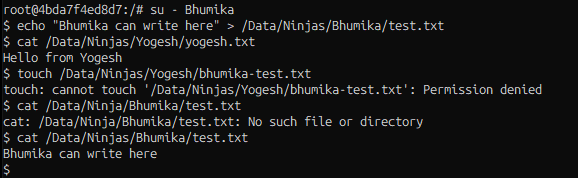

------------------------------------------------------------------------

# Final Verification

## Part 1

``` text
Domain:
yogesh.pirates.com

Working Hours:
10 AM - 12 PM → Hello from Yogesh
4 PM - 6 PM   → Hello from Shubham Rathi
```

## Part 2

``` text
User       Own Directory       Other Directory
------------------------------------------------
Yogesh     Read + Write        Read Only
Bhumika    Read Only           Read + Write
```

------------------------------------------------------------------------

# Conclusion

This assignment demonstrates practical Docker and Linux concepts
including:

-   Docker image creation
-   Docker container management
-   Nginx configuration
-   Static website hosting
-   Local domain configuration
-   Shell scripting
-   Runtime configuration
-   Time-based application behavior
-   Linux users
-   File ownership
-   File permissions
-   Access control testing

**Author:** Yogesh Indoria\
**Team:** Pirates\
**Assignment:** Docker Assignment 01

----------
