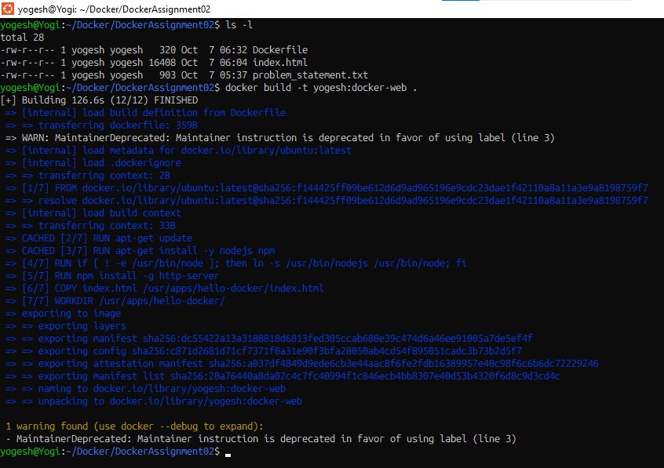
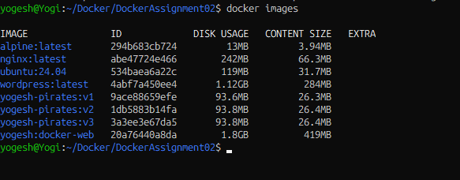
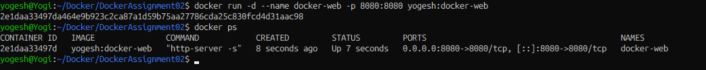
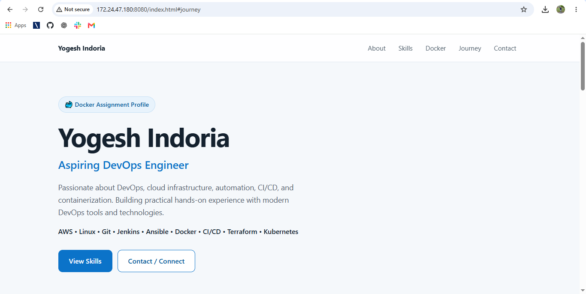
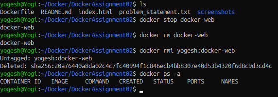

# Docker Assignment 02 — Static Website using Docker

> **Author:** Yogesh Indoria

## 📑 Table of Contents

- [Objective](#objective)
- [Technologies Used](#technologies-used)
- [Project Structure](#project-structure)
- [1. Create Project Directory](#1-create-project-directory)
- [2. Create `index.html`](#2-create-indexhtml)
- [3. Create Dockerfile](#3-create-dockerfile)
  - [Dockerfile Instructions Explained](#dockerfile-instructions-explained)
- [4. Build Docker Image](#4-build-docker-image)
- [5. Verify Docker Image](#5-verify-docker-image)
- [6. Run Docker Container](#6-run-docker-container)
  - [Port Mapping](#port-mapping)
- [7. Access the Webpage](#7-access-the-webpage)
- [8. Final Architecture](#8-final-architecture)
- [9. Cleanup](#9-cleanup)
  - [Stop the Container](#stop-the-container)
  - [Remove the Container](#remove-the-container)
  - [Remove the Docker Image](#remove-the-docker-image)
  - [Verify Cleanup](#verify-cleanup)
- [10. Assignment Requirements Checklist](#10-assignment-requirements-checklist)
- [Author](#author)

---

## 🎯 Objective

The objective of this assignment is to create a Docker image using an Ubuntu base image, install Node.js and npm, install the `http-server` package, copy a local `index.html` file into the container, and serve the webpage through port `8080`.

This assignment demonstrates the basic Docker workflow:

**Dockerfile → Docker Image → Docker Container → Port Mapping → Web Browser**

---

## 🛠️ Technologies Used

- Docker
- Ubuntu Latest
- Node.js
- npm
- http-server
- HTML
- Linux / WSL

---

## 📁 Project Structure

```text
DockerAssignment02/
│
├── Dockerfile
├── index.html
├── problem_statement.txt
└── README.md
```

---

# 1. Create Project Directory

The assignment was performed inside the `DockerAssignment02` directory.

```bash
mkdir DockerAssignment02
cd DockerAssignment02
```

The project directory contains the required files:

```text
Dockerfile
index.html
problem_statement.txt
```

---

# 2. Create `index.html`

A test HTML webpage was created locally.

```html
<!DOCTYPE html>
<html>
<head>
    <title>Hello Docker</title>
</head>
<body>
    <h1>Hello from Docker!</h1>
    <h2>Yogesh Indoria</h2>
    <p>This webpage is running inside a Docker container.</p>
</body>
</html>
```

The HTML file is later copied into the container at:

```text
/usr/apps/hello-docker/index.html
```

---

# 3. Create Dockerfile

The Dockerfile contains all instructions required to build the Docker image.

```dockerfile
FROM ubuntu:latest

MAINTAINER Yogesh Indoria

RUN apt-get update

RUN apt-get install -y nodejs npm

RUN if [ ! -e /usr/bin/node ]; then ln -s /usr/bin/nodejs /usr/bin/node; fi

RUN npm install -g http-server

COPY index.html /usr/apps/hello-docker/index.html

WORKDIR /usr/apps/hello-docker/

CMD ["http-server", "-s"]
```

## Dockerfile Instructions Explained

| Instruction | Purpose |
|---|---|
| `FROM ubuntu:latest` | Uses Ubuntu latest as the base image |
| `MAINTAINER Yogesh Indoria` | Adds the assignment author/maintainer |
| `RUN apt-get update` | Updates Ubuntu package information |
| `RUN apt-get install -y nodejs npm` | Installs Node.js and npm |
| `RUN if ... ln -s ...` | Creates the `node` symlink when required |
| `RUN npm install -g http-server` | Installs the HTTP server globally |
| `COPY index.html ...` | Copies the local webpage into the container |
| `WORKDIR ...` | Sets the working directory |
| `CMD ["http-server", "-s"]` | Starts the HTTP server when the container starts |

> **Note:** The `MAINTAINER` instruction is deprecated in modern Docker, but it was retained because it is explicitly required by this assignment.

---

# 4. Build Docker Image

The Docker image was built using:

```bash
docker build -t yogesh:docker-web .
```

The image was successfully created with the required tag:

```text
yogesh:docker-web
```



---

# 5. Verify Docker Image

The created image was verified using:

```bash
docker images
```

The required image appears as:

```text
yogesh   docker-web
```



---

# 6. Run Docker Container

The container was started with host port `8080` mapped to container port `8080`.

```bash
docker run -d --name docker-web -p 8080:8080 yogesh:docker-web
```

## Port Mapping

```text
Host Port 8080
      │
      ▼
Container Port 8080
```

The running container was verified using:

```bash
docker ps
```



---

# 7. Access the Webpage

The webpage was successfully accessed from the browser using:

```text
http://localhost:8080/index.html
```

The Docker container served the `index.html` file using `http-server`.



---

# 8. Final Architecture

```text
                 Local Machine / WSL
                         │
                         │ docker build
                         ▼
                ┌──────────────────┐
                │  Docker Image    │
                │ yogesh:docker-web│
                └────────┬─────────┘
                         │
                         │ docker run
                         ▼
                ┌──────────────────┐
                │ Docker Container │
                │   docker-web     │
                │                  │
                │  http-server     │
                │  index.html      │
                └────────┬─────────┘
                         │
                   Port 8080
                         │
                         ▼
                    Web Browser
                         │
                         ▼
             http://localhost:8080
```

---

# 9. Cleanup

After completing the testing, the Docker container and image were removed from the local system as required by the assignment.

## Stop the Container

```bash
docker stop docker-web
```

## Remove the Container

```bash
docker rm docker-web
```

## Remove the Docker Image

```bash
docker rmi yogesh:docker-web
```

## Verify Cleanup

```bash
docker ps -a
docker images
```

The `docker-web` container and `yogesh:docker-web` image were successfully removed.



---

# 10. Assignment Requirements Checklist

- [x] Use Ubuntu latest image
- [x] Add name as Maintainer
- [x] Run `apt-get update`
- [x] Install Node.js
- [x] Install npm
- [x] Create Node.js symlink requirement
- [x] Install `http-server`
- [x] Copy `index.html` into `/usr/apps/hello-docker/`
- [x] Set working directory to `/usr/apps/hello-docker/`
- [x] Start `http-server -s` when the container initializes
- [x] Build image as `yogesh:docker-web`
- [x] Run container with `8080:8080`
- [x] Access webpage through browser
- [x] Verify the running container
- [x] Clean up Docker container and image

---

## 👨‍💻 Author

**Yogesh Indoria**

Aspiring DevOps Engineer | AWS | Linux | Git | Jenkins | Ansible | Docker | Terraform | Kubernetes

---
 
### 🔝 Back to Top

[⬆️ Back to Top](#docker-assignment-02--static-website-using-docker)