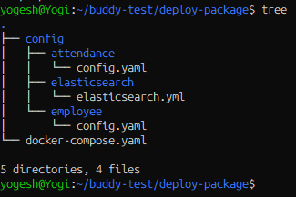
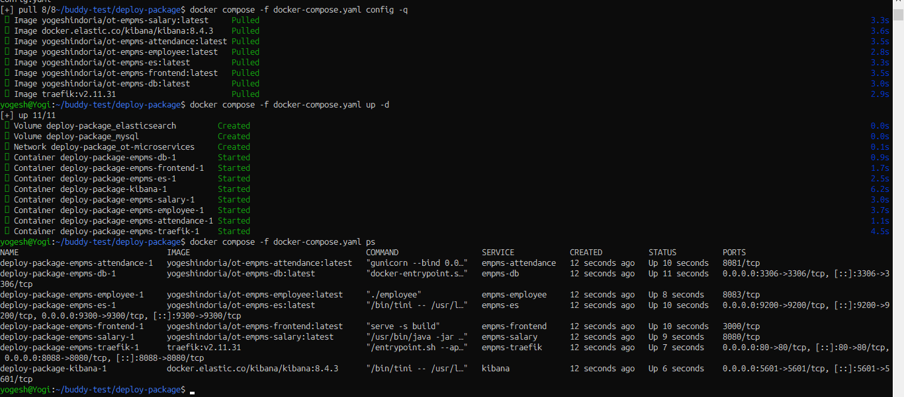
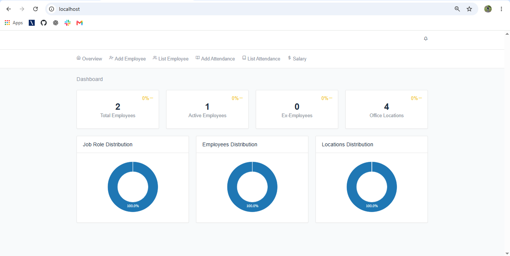
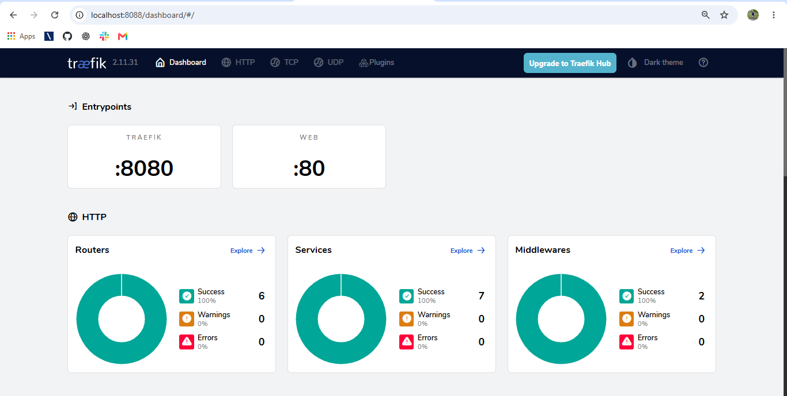
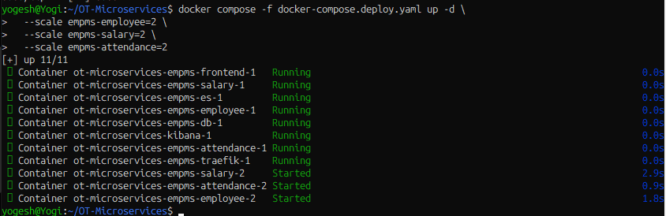
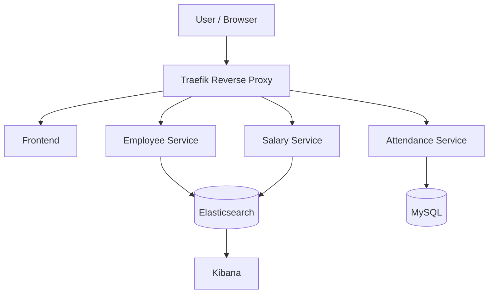

# OT-Microservices --- Dockerization and Registry-Based Deployment

**Author:** Yogesh Indoria

## Objective

The objective of this assignment was to set up the OT-Microservices
application, build Docker images for its services, push the images to
Docker Hub, and deploy the application using Docker Compose **without
cloning the source repository on the deployment machine**. We also
started multiple replicas of Employee, Salary, and Attendance to
practise scaling.

## 1. Project Setup

We cloned the OT-Microservices repository and reviewed its services,
Dockerfiles, and Compose configuration.

## 2. Fixing Build Issues

We fixed the build issues encountered while creating the images,
including the frontend Node.js base image and Salary service Java
compilation issues.

## 3. Building Docker Images

We built the application images locally for these components:

-   Employee
-   Salary
-   Attendance
-   Frontend
-   Database
-   Elasticsearch

**Screenshot to add:** Output of `docker images` showing the six local
application images.


## 4. Pushing Images to Docker Hub Registry

We tagged the application images with the Docker Hub namespace
`yogeshindoria` and pushed them to Docker Hub so the deployment machine
could pull them without building from source.

Images pushed:

-   `yogeshindoria/ot-empms-employee:latest`
-   `yogeshindoria/ot-empms-salary:latest`
-   `yogeshindoria/ot-empms-attendance:latest`
-   `yogeshindoria/ot-empms-frontend:latest`
-   `yogeshindoria/ot-empms-db:latest`
-   `yogeshindoria/ot-empms-es:latest`

**Screenshot to add:** Docker Hub repositories page showing all six
repositories. A terminal screenshot showing successful `docker push`
output is also useful.


## 5. Creating an Image-Only Deployment Compose File

We created `docker-compose.deploy.yaml` using pre-built image references
(`image:`) rather than local source builds (`build:`). This lets Docker
Compose pull images from Docker Hub.

## 6. Preparing the Deployment Package

We collected the Compose file and the configuration files needed by the
services into a deployment package.

``` text
deploy-package/
├── docker-compose.yaml
└── config/
    ├── attendance/
    │   └── config.yaml
    ├── elasticsearch/
    │   └── elasticsearch.yml
    └── employee/
        └── config.yaml
```

We packaged the folder as `ot-microservices-deployment.zip`.

**Screenshot to add:** The extracted package structure and the ZIP file
visible in the terminal or file manager.



## 7. Pulling Images and Starting the Application

From the deployment package, we validated the Compose configuration,
pulled the pre-built images, and started the services.

``` bash
docker compose -f docker-compose.yaml config -q
docker compose -f docker-compose.yaml pull
docker compose -f docker-compose.yaml up -d
docker compose -f docker-compose.yaml ps
```

**Screenshot to add:** Successful image pull output and
`docker compose ps` showing running containers.



## 8. Verifying the Application and Employee API

We opened the frontend in a browser at `http://localhost/`. We also
created a sample employee using the Employee API and verified the search
endpoint.

Example API calls:

``` bash
curl -i -X POST http://localhost/employee/create \
  -H "Content-Type: application/json" \
  -d '{
    "id": "EMP001",
    "name": "Test Employee",
    "job_role": "Software Developer",
    "joining_date": "2026-10-13",
    "address": "Palwal",
    "location": "Haryana",
    "status": "active",
    "email": "test@example.com",
    "annual_package": 600000,
    "phone_number": "9999999999"
  }'
```

``` bash
curl -i http://localhost/employee/search/all
```

**Screenshots to add:** Frontend open in the browser and successful
Employee API response.

  

## 9. Scaling Employee, Salary, and Attendance

We used Docker Compose to start two replicas of each application
service:

``` bash
docker compose -f docker-compose.deploy.yaml up -d \
  --scale empms-employee=2 \
  --scale empms-salary=2 \
  --scale empms-attendance=2
```

We checked the resulting containers using `docker compose ps`.

**Screenshot to add:** Terminal output showing two Employee, two Salary,
and two Attendance containers.



This confirms that multiple replicas were started. Load-balancing and
failover should be tested separately before claiming production-grade
high availability.

## Architecture



## Deployment on Another Machine

### Prerequisites

-   Docker Engine installed and running
-   Docker Compose plugin
-   Internet access to pull images from Docker Hub
-   Required host ports available, including `80`, `3306`, `5601`,
    `9200`, and `8088`

### Steps

1.  Copy `ot-microservices-deployment.zip` to the target machine.
2.  Extract the ZIP and enter the `deploy-package` directory.
3.  Run:

``` bash
docker compose pull
docker compose up -d
docker compose ps
```

## Access URLs

  Component           URL
  ------------------- ------------------------------------
  Frontend            `http://localhost/`
  Traefik dashboard   `http://localhost:8088/dashboard/`
  Kibana              `http://localhost:5601/`
  Elasticsearch       `http://localhost:9200/`

## Useful Commands

``` bash
# Check container status
docker compose ps

# Follow logs
docker compose logs -f

# Stop containers; named volumes are retained by default
docker compose down
```

> **Warning:** `docker compose down -v` removes named volumes and may
> permanently delete persisted database/search data.

## Summary

We set up the project, fixed build issues, built and tagged Docker
images, pushed them to Docker Hub, created an image-only Compose file,
packaged the configuration files, pulled images from the registry,
deployed the application from the package, tested the frontend and
Employee API, and started multiple replicas of Employee, Salary, and
Attendance.

##
